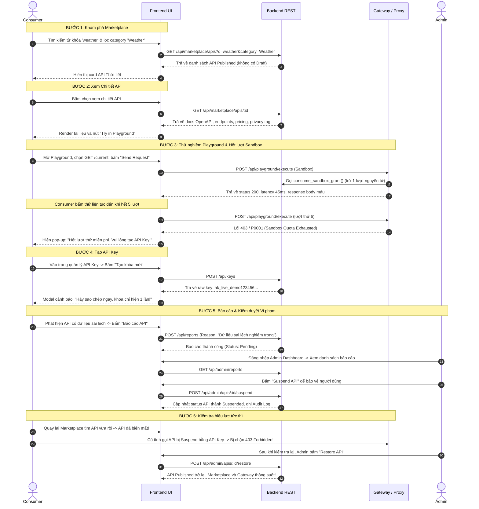

# Sprint 3 — Danh mục Test Cases Kiểm thử Toàn diện & Checklist Bảo mật

> **Dự án:** API Marketplace & Management
> **Tài liệu QA Lead:** Trần Hà Thảo Vân (`@vuonghathaovan-gif` — Issue #15)
> **Phạm vi kiểm thử:** US-16, US-17, US-18, US-19, US-21, US-22, US-15, US-05
> **Tiêu chuẩn áp dụng:** ISO/IEC/IEEE 29119, OWASP Top 10 API Security Risks, Quy trình quản lý bug `docs/05-quy-trinh-quan-ly-bug.md`

---

## 1. THỐNG KÊ TỔNG QUAN BỘ TEST CASES SPRINT 3

| Nhóm Kiểm thử | Mã User Story | Số lượng TC | Critical | High | Medium | Loại kiểm thử |
|---|---|:---:|:---:|:---:|:---:|---|
| **Marketplace Discovery** | US-16 | 7 | 2 | 4 | 1 | Functional, Negative, DB |
| **API Detail & Documentation** | US-17 | 6 | 2 | 3 | 1 | Functional, Security, Data Leak |
| **Playground & Anti-SSRF** | US-18 | 7 | 3 | 3 | 1 | Security, Functional, Edge Case |
| **Try Before Subscribe & Quota** | US-19 | 5 | 2 | 2 | 1 | Functional, Concurrency, State |
| **API Key Lifecycle** | US-21 | 6 | 2 | 3 | 1 | Security, Functional, DB |
| **Gateway Routing Framework** | US-22 | 5 | 2 | 2 | 1 | Functional, Security, Lifecycle |
| **Report & Moderation** | US-15 | 5 | 1 | 3 | 1 | Functional, Integration, State |
| **User Profile & Security** | US-05 | 5 | 1 | 3 | 1 | Functional, Security, Negative |
| **TỔNG CỘNG** | **8 User Stories** | **46** | **15** | **23** | **8** | **Đầy đủ Functional & Non-Functional** |

---

## 2. DANH MỤC TEST CASES CHI TIẾT

---

### US-16 — Tìm kiếm, Lọc, Sắp xếp & Phân trang Marketplace

| ID | Ưu tiên | Loại test | Tiền điều kiện | Các bước thực hiện | Dữ liệu đầu vào | Kết quả mong đợi |
|---|:---:|:---:|---|---|---|---|
| **TC-16-01** | Critical | Functional | Có $\ge 1$ API `Published` | Gọi `GET /api/marketplace/apis` không kèm query | Không có | Trả về `200 OK`; danh sách chỉ chứa API `Published`; mỗi item có đủ trường public summary |
| **TC-16-02** | High | Functional | Có API chứa từ khóa trong tên/mô tả | Gọi `GET /api/marketplace/apis?q=weather` | `q: "weather"` | Tìm kiếm không phân biệt hoa thường (`Weather`, `WEATHER` đều khớp); trả về đúng các API liên quan |
| **TC-16-03** | High | Negative | Database có API chứa ký tự `%` hoặc `_` | Gọi `GET /api/marketplace/apis?q=%` | `q: "%"` | Trả về `200 OK`; xử lý `%` như ký tự chuỗi thông thường, không quét wildcard toàn bộ DB |
| **TC-16-04** | High | Functional | Có API thuộc danh mục và gắn tag | Gọi `GET /api/marketplace/apis?category=Finance&tag=payment` | `category: "Finance"`, `tag: "payment"` | Lọc kết hợp điều kiện logic AND; chỉ trả về API vừa thuộc Finance vừa chứa tag payment |
| **TC-16-05** | High | Functional | Có API có gói Free (0đ) và gói Paid (>0đ) | Gọi `GET /api/marketplace/apis?pricing=free` và `?pricing=paid` | `pricing: "free"` / `pricing: "paid"` | Khớp chính xác API có gói active giá 0 hoặc > 0; API có cả hai gói xuất hiện ở cả hai bộ lọc |
| **TC-16-06** | Medium | Functional | Nhiều API `Published` | Gọi với `sort=newest` và `sort=name`, `page=1&pageSize=10` | `sort: "newest"`, `pageSize: 10` | Sắp xếp ổn định (`published_at DESC, id DESC`); phân trang và `total` nhất quán trên cùng snapshot |
| **TC-16-07** | Critical | Security | Có API ở trạng thái `Draft`, `Under Review`, `Suspended` | Gọi `GET /api/marketplace/apis` | Không có | Tuyệt đối không xuất hiện bất kỳ API nào có trạng thái khác `Published` trong kết quả |

---

### US-17 — Chi tiết API Công khai (API Detail & Public Documentation)

| ID | Ưu tiên | Loại test | Tiền điều kiện | Các bước thực hiện | Dữ liệu đầu vào | Kết quả mong đợi |
|---|:---:|:---:|---|---|---|---|
| **TC-17-01** | Critical | Functional | API `Published` có docs OpenAPI và pricing | Gọi `GET /api/marketplace/apis/{id}` | `id` của API `Published` | Trả về `200 OK` đầy đủ versions, endpoints, documentation OpenAPI, plans active, legal declaration |
| **TC-17-02** | Critical | Security | API có hồ sơ duyệt, bằng chứng KYC và challenge domain | Gọi `GET /api/marketplace/apis/{id}` | `id` hợp lệ | Kiểm tra payload: không chứa `evidenceUrls`, `challenge_token`, `review_notes`, `reject_reason` |
| **TC-17-03** | High | Negative | API đang ở trạng thái `Draft` | Gọi trực tiếp `GET /api/marketplace/apis/{draftId}` | `id` của API Draft | Trả về HTTP `404 Not Found` (`NOT_FOUND`), không để lộ thông tin API đang nháp |
| **TC-17-04** | High | Negative | API của Provider bị Admin khóa tài khoản | Gọi `GET /api/marketplace/apis/{lockedProviderApiId}` | `id` của API thuộc Provider bị khóa | Trả về HTTP `404 Not Found`, bảo vệ chính sách ngắt dịch vụ của tài khoản vi phạm |
| **TC-17-05** | Medium | Negative | ID không tồn tại hoặc sai định dạng | Gọi `GET /api/marketplace/apis/abc` hoặc `9999999` | `id: "abc"` hoặc `id: 9999999` | Trả về `400 Bad Request` (sai pattern số) hoặc `404 Not Found` (không tồn tại) |
| **TC-17-06** | High | Functional | API có gói giá bị deactive | Gọi `GET /api/marketplace/apis/{id}` | `id` hợp lệ | Mảng `plans` chỉ chứa các gói `is_active = TRUE`, ẩn hoàn toàn các gói giá đã ngưng áp dụng |

---

### US-18 — Thử nghiệm API Trực quan (Playground) & Phòng chống SSRF

| ID | Ưu tiên | Loại test | Tiền điều kiện | Các bước thực hiện | Dữ liệu đầu vào | Kết quả mong đợi |
|---|:---:|:---:|---|---|---|---|
| **TC-18-01** | High | Functional | API `Published` có mock server hoạt động | Consumer gửi request qua Playground tới endpoint hợp lệ | Method `GET`, Path `/current`, Header `X-Test: 1` | Chuyển tiếp thành công; trả về Status `200`, Body JSON, Response Headers và đo được Latency (ms) |
| **TC-18-02** | Critical | Security | Kẻ tấn công cố tình gọi loopback nội bộ | Gửi request qua Playground tới `http://127.0.0.1:3000/api/admin` hoặc `http://localhost:8080` | Host `127.0.0.1` hoặc `localhost` | Bị chặn ngay lập tức với HTTP `400/403` (`SSRF_DETECTED`), không mở kết nối socket |
| **TC-18-03** | Critical | Security | Kẻ tấn công gọi dải mạng private LAN | Gửi request tới `http://192.168.1.1` hoặc `http://10.0.0.1` | Dải IP RFC 1918 | Bị chặn ngay lập tức trước khi forward (`SSRF_DETECTED`) |
| **TC-18-04** | Critical | Security | Gọi tới Cloud Metadata Service | Gửi request tới `http://169.254.169.254/latest/meta-data/` | Link-local IP | Bị chặn tức thì, bảo vệ máy chủ không bị đánh cắp IAM credentials |
| **TC-18-05** | High | Security | Upstream trả về HTTP `302 Redirect` tới URL nội bộ | Gọi endpoint upstream chuyển hướng về `http://127.0.0.1:5432` | Chuyển hướng Redirect | Proxy cấm follow redirect (`maxRedirects: 0`); trả về kết quả response 302 thay vì tự động đi theo |
| **TC-18-06** | High | Edge Case | Upstream bị treo hoặc phản hồi chậm | Gửi request tới endpoint có độ trễ lớn hơn 10 giây | Server upstream trễ | Proxy tự động ngắt kết nối sau timeout quy định; trả về HTTP `504 Gateway Timeout` |
| **TC-18-07** | Medium | Negative | Gửi request tới path không nằm trong danh sách endpoint đăng ký | Chọn path tùy ý không thuộc OpenAPI (`/admin/secret`) | Path chưa đăng ký | Bị từ chối với HTTP `400 Bad Request` (`ENDPOINT_NOT_REGISTERED`) |

---

### US-19 — Trải nghiệm Dùng thử (Try Before Subscribe & Sandbox Quota)

| ID | Ưu tiên | Loại test | Tiền điều kiện | Các bước thực hiện | Dữ liệu đầu vào | Kết quả mong đợi |
|---|:---:|:---:|---|---|---|---|
| **TC-19-01** | High | Functional | Consumer chưa từng thử API này | Mở Playground và gửi request đầu tiên | Request hợp lệ | Hệ thống cấp bản ghi `sandbox_grants` với `max_requests: 5`, trừ 1 lượt, báo còn 4 lượt |
| **TC-19-02** | Critical | Concurrency | Consumer còn 1 lượt dùng thử duy nhất | Dùng script gửi 5 request đồng thời trong cùng 1 thời điểm | 5 concurrent requests | Chỉ duy nhất 1 request thành công; 4 request còn lại bị từ chối; `used_requests` không vượt quá `max_requests` |
| **TC-19-03** | High | Functional | Consumer đã tiêu thụ hết quota (5/5 lượt) | Tiếp tục nhấn "Send Request" trong Playground | Request thử nghiệm | Bị chặn ngay tại backend (hàm `consume_sandbox_grant` trả lỗi); UI hiện modal hết lượt + CTA "Subscribe" |
| **TC-19-04** | High | State Persistence | Consumer đã dùng 3/5 lượt thử | Tải lại trang (F5), mở tab ẩn danh hoặc đổi thiết bị | Đăng nhập tài khoản Consumer | UI hiển thị chính xác "Còn lại 2/5 lượt thử", không bị reset lại thành 5 lượt |
| **TC-19-05** | Medium | Functional | Sandbox grant có `expires_at < NOW()` | Consumer gửi request khi phiên đã quá 24h | Token đã hết hạn | Bị từ chối do grant hết hạn; yêu cầu người dùng đăng ký gói cước |

---

### US-21 — Quản lý Vòng đời Khóa API (API Key Lifecycle Management)

| ID | Ưu tiên | Loại test | Tiền điều kiện | Các bước thực hiện | Dữ liệu đầu vào | Kết quả mong đợi |
|---|:---:|:---:|---|---|---|---|
| **TC-21-01** | Critical | Security | Consumer đã đăng nhập | Gọi API tạo mới API Key cho một API | `{ label: "Production Key" }` | Response trả về raw key 1 lần duy nhất; DB bảng `api_keys` chỉ lưu `key_prefix` và `key_hash` (SHA-256) |
| **TC-21-02** | Critical | DB Verification | Khóa vừa tạo ở TC-21-01 | Kiểm tra trực tiếp dữ liệu cột `key_hash` trong PostgreSQL | Query SQL bảng `api_keys` | Khớp regex `^[0-9a-f]{64}$`; không tìm thấy giá trị plaintext của raw key ở bất kỳ bảng/cột nào |
| **TC-21-03** | High | Functional | Đang có 1 khóa active | Consumer thực hiện Rotate Key | Yêu cầu Rotate | Khóa cũ chuyển `is_active: false`, `revoked_at` có thời gian; sinh khóa mới thay thế |
| **TC-21-04** | High | Security | Khóa cũ vừa bị Rotate ở TC-21-03 | Dùng khóa cũ gửi request tới Gateway | Header `X-API-Key: <khoa_cu>` | Gateway lập tức từ chối với HTTP `401 Unauthorized` |
| **TC-21-05** | High | Functional | Consumer có khóa active | Nhấn "Revoke Key" | Xác nhận thu hồi | Khóa chuyển `is_active: false`; request dùng khóa này bị từ chối tức thì |
| **TC-21-06** | Medium | Functional | Gửi request qua Gateway thành công bằng API Key | Gọi endpoint qua Gateway với key active | Request hợp lệ | Trường `last_used_at` của key trong DB được cập nhật thời gian hiện tại |

---

### US-22 — Cổng Giao tiếp Định tuyến (Gateway Routing Framework)

| ID | Ưu tiên | Loại test | Tiền điều kiện | Các bước thực hiện | Dữ liệu đầu vào | Kết quả mong đợi |
|---|:---:|:---:|---|---|---|---|
| **TC-22-01** | Critical | Functional | Route đã được đăng ký và `is_enabled = TRUE` | Gửi request qua Gateway kèm `X-API-Key` hợp lệ | Request tới route demo | Gateway forward request tới upstream tương ứng; nhận và trả kết quả chính xác cho client |
| **TC-22-02** | Critical | Security | API bị Admin chuyển sang `Suspended` | Gửi request qua Gateway tới API bị suspend | API Key hợp lệ | Gateway từ chối ngay lập tức với HTTP `403 Forbidden` (`API_SUSPENDED`), không chuyển tiếp tới upstream |
| **TC-22-03** | High | Security | Request gửi qua Gateway không kèm API Key | Gửi request thiếu header `X-API-Key` | Header rỗng | Gateway trả về HTTP `401 Unauthorized` (`MISSING_API_KEY`) |
| **TC-22-04** | High | Functional | Route bị tạm ngắt (`is_enabled = FALSE`) | Gửi request qua Gateway | API Key hợp lệ | Gateway trả về HTTP `503 Service Unavailable` (`ROUTE_DISABLED`) |
| **TC-22-05** | Medium | Security | Client cố tình chèn header nội bộ `X-Internal-Actor: admin` | Gửi request kèm header giả mạo qua Gateway | Header giả mạo | Gateway tự động lọc/xóa bỏ header nhạy cảm trước khi gửi tới máy chủ upstream |

---

### US-15 — Báo cáo Vi phạm & Kiểm duyệt Nội dung (Report & Moderation)

| ID | Ưu tiên | Loại test | Tiền điều kiện | Các bước thực hiện | Dữ liệu đầu vào | Kết quả mong đợi |
|---|:---:|:---:|---|---|---|---|
| **TC-15-01** | High | Functional | Consumer đăng nhập, xem API trên Marketplace | Gửi form báo cáo vi phạm | `reason: "API trả về mã độc"`, `category: "Malware"` | Hệ thống tạo bản ghi báo cáo `Pending`; trả về `201 Created` kèm mã báo cáo |
| **TC-15-02** | Critical | Integration | API đang `Published` bị nhiều báo cáo | Admin thực hiện hành động đình chỉ (`Suspend`) | `{ action: "Suspend", reason: "Phát hiện mã độc" }` | Trạng thái API chuyển `Suspended`; biến mất khỏi Marketplace; Gateway & Playground chặn ngay; ghi `audit_logs` |
| **TC-15-03** | High | Integration | API đang bị `Suspended` | Admin thực hiện hành động phục hồi (`Restore`) | `{ action: "Restore", note: "Đã khắc phục lỗi" }` | API chuyển lại `Published`; xuất hiện trở lại trên Marketplace; Gateway mở lại lưu lượng; ghi `audit_logs` |
| **TC-15-04** | High | Security | Consumer hoặc Provider cố tình gọi endpoint duyệt report | Gửi request duyệt report bằng token không phải Admin | Quyền không phải Admin | Hệ thống từ chối với HTTP `403 Forbidden` |
| **TC-15-05** | Medium | Functional | Admin xem danh sách báo cáo vi phạm | Gọi `GET /api/admin/reports?status=Pending` | Query `status=Pending` | Trả về `200 OK` danh sách các báo cáo đang chờ xử lý có phân trang |

---

### US-05 — Quản lý Hồ sơ Cá nhân & Đổi Mật khẩu An toàn

| ID | Ưu tiên | Loại test | Tiền điều kiện | Các bước thực hiện | Dữ liệu đầu vào | Kết quả mong đợi |
|---|:---:|:---:|---|---|---|---|
| **TC-05-01** | High | Functional | Người dùng đã đăng nhập | Gọi `GET /api/user/profile` | Token hợp lệ | Trả về `200 OK` gồm thông tin tên hiển thị, email, vai trò (role) |
| **TC-05-02** | High | Functional | Người dùng muốn đổi tên | Gọi `PUT /api/user/profile` với tên mới | `{ name: "Nguyễn Văn Mới" }` | Cập nhật thành công tên hiển thị; email và role không bị thay đổi |
| **TC-05-03** | Critical | Security | Người dùng đổi mật khẩu với mật khẩu cũ chính xác | Gửi `POST /api/user/change-password` | `currentPassword` đúng, `newPassword` hợp lệ $\ge 8$ ký tự | Trả về `200 OK`; cập nhật mật khẩu băm mới; thu hồi các Refresh Token cũ |
| **TC-05-04** | High | Negative | Nhập sai mật khẩu hiện tại | Gửi `POST /api/user/change-password` với mật khẩu cũ sai | `currentPassword: "sai_mat_khau"` | Trả về `400 Bad Request` (`INVALID_CURRENT_PASSWORD`); không đổi mật khẩu |
| **TC-05-05** | Medium | Negative | Đặt mật khẩu mới trùng mật khẩu cũ | Gửi `POST /api/user/change-password` với `newPassword == currentPassword` | Mật khẩu mới trùng mật khẩu cũ | Trả về `400 Bad Request` (`NEW_PASSWORD_SAME_AS_OLD`) |

---

## 3. CHECKLIST BẢO MẬT CHUYÊN BIỆT (SECURITY CHECKLIST)

### A. Kiểm thử Phòng chống SSRF trên Playground (US-18)
- [ ] **Chặn Loopback IPv4 & IPv6:** Thử nghiệm gọi tới `127.0.0.1`, `127.0.1.1`, `localhost`, `0.0.0.0`, `[::1]`, `[0:0:0:0:0:0:0:1]` $\to$ Phải trả lỗi `400/403`.
- [ ] **Chặn Private Subnet (RFC 1918):** Thử nghiệm gọi dải `10.0.0.0/8`, `172.16.0.0/12`, `192.168.0.0/16` $\to$ Phải bị từ chối trước khi mở socket.
- [ ] **Chặn Cloud Metadata Service:** Thử nghiệm gọi `http://169.254.169.254/` và `http://metadata.google.internal/` $\to$ Bị chặn hoàn toàn.
- [ ] **Chặn Open Redirect Bypass:** Máy chủ upstream trả về `301/302 Redirect` tới IP nội bộ $\to$ Proxy không follow redirect (`maxRedirects: 0`).
- [ ] **Chặn DNS Rebinding:** Phân giải IP tại thời điểm kết nối socket thực tế (TCP connect level validation).
- [ ] **Giới hạn thời gian và kích thước:** Timeout tối đa 10s, kích thước tối đa 2MB $\to$ Chống tấn công làm cạn kiệt tài nguyên máy chủ (Denial of Service).

### B. Kiểm thử An toàn Khóa API (API Key Security - US-21)
- [ ] **Nguyên tắc "Chỉ hiển thị 1 lần":** Giao diện và API chỉ trả về giá trị raw key khi tạo mới hoặc rotate. Khi lấy danh sách, chỉ hiển thị `key_prefix` (ví dụ: `ak_live_a1b2...****`).
- [ ] **Kiểm tra lưu trữ Cơ sở Dữ liệu:** Xác nhận trong bảng `api_keys` chỉ có cột `key_hash` dạng SHA-256 (64 hex). Không tồn tại plaintext key trong DB.
- [ ] **Kiểm tra Logs & Trace:** Quét toàn bộ console logs, access logs, audit logs và error traces $\to$ Không được in chuỗi raw key hoặc header Authorization.
- [ ] **Vô hiệu hóa tức thì:** Sau khi rotate hoặc revoke, khóa cũ phải bị vô hiệu hóa ngay trên Gateway trong vòng dưới 1 giây.

### C. Kiểm thử Chống Bypass Quota Dùng thử (Sandbox Quota - US-19)
- [ ] **Tính nguyên tử (Concurrency Test):** Gửi 10 request đồng thời khi chỉ còn 1 lượt dùng thử $\to$ Đảm bảo đúng 1 request thành công, không bị âm lượt hoặc tràn quota.
- [ ] **Kiểm tra Persistence:** Tải lại trang (F5), xóa cookie/localStorage trình duyệt $\to$ Số lượt thử được bảo toàn từ máy chủ.

---

## 4. KỊCH BẢN DEMO CUỐI SPRINT 3 (UAT END-TO-END SCENARIO)

**Mục tiêu kịch bản:** Chứng minh trọn vẹn hành trình của Consumer trên sàn thương mại điện tử API từ khám phá, thử nghiệm, chuyển đổi sang lấy khóa API, và quy trình xử lý vi phạm của Admin.

