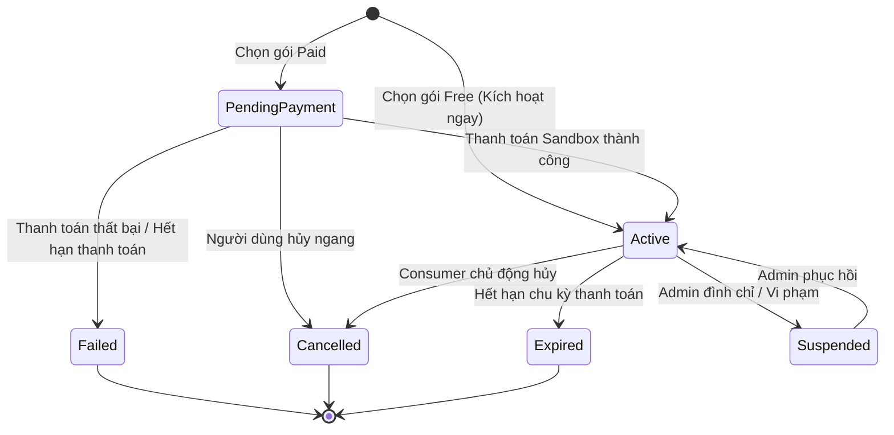
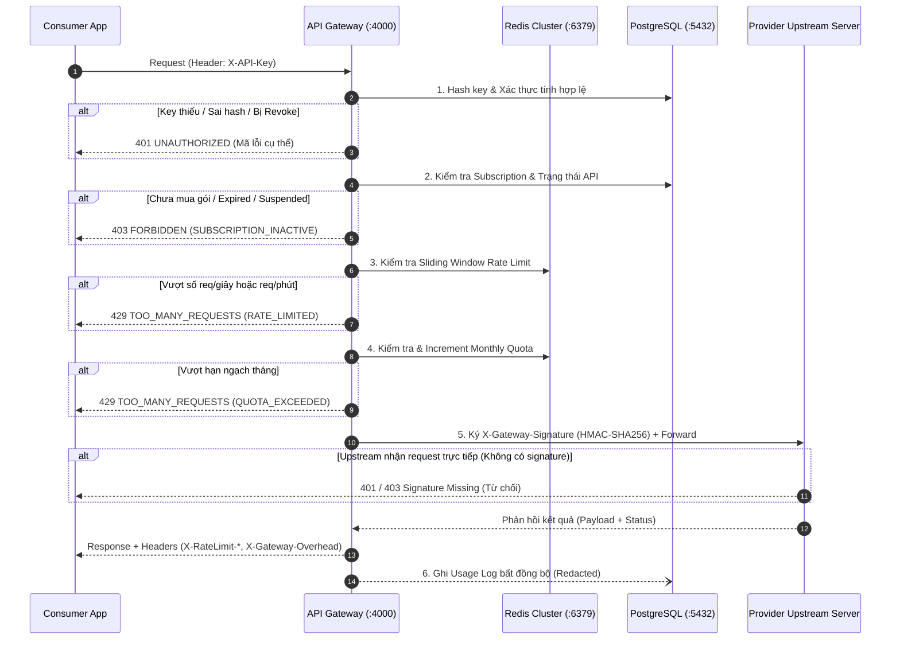

# Sprint 4 — Tiêu chí Chấp nhận (Acceptance Criteria) & Ma trận RBAC

> **Dự án:** API Marketplace & Management Platform
> **Tài liệu QA Lead:** Trần Hà Thảo Vân (`@vuonghathaovan-gif` — Issue #15 & Issue #70)
> **Phạm vi Sprint 4:** `EP09` (Pricing, Subscription & Payment Sandbox), `EP08` (API Gateway Enforcement, Upstream Signing & Sensitive Data Redaction), `EP10` (Usage Tracking, Request History & Code Generator), `EP04` (Admin Subscription Monitoring & Worker Automation).
> **Mã Backlog:** `US-20`, `US-23`, `US-24`, `US-25`, `US-26`, `US-27`, `US-28`, `EN-09`, `EN-11`.
> **Căn cứ kỹ thuật:** `docs/01-kien-truc-he-thong.md`, `docs/02-role-va-phan-quyen.md`, `migrations/sprint3-usage-log-design.md`, `backend/SPRINT-3-CONSUMER-HANDOFF.md`, `docs/test/Sprint3_AcceptanceCriteria.md`.
> **Cột mốc dự án:** Sprint 4 là điểm nóng kỹ thuật cao nhất (67 điểm effort) chuẩn bị cho **Feature Freeze toàn hệ thống (09/11/2026)**.

---

## BẢNG TỔNG HỢP PHẠM VI KIỂM THỬ SPRINT 4

| Nhóm Epic | Mã US | Tên phân hệ / Chức năng | Thành phần phụ trách | Số lượng AC | Độ ưu tiên MoSCoW |
|---|---|---|---|:---:|:---:|
| **EP09** | `US-20`<br>`US-25` | **Pricing, Subscription & Payment Sandbox**<br>Đăng ký gói Free/Paid, cổng thanh toán Sandbox, cấp phát quota, State Machine. | Danh (DB)<br>Tùng Dương (BE)<br>Hải Dương (FE) | 5 AC<br>(`AC-S4-01` $\to$ `05`) | **Must-Have** |
| **EP08** | `US-23` | **API Gateway Enforcement & Upstream Signing**<br>Thực thi bảo vệ đa tầng (401, 403, 429), ký HMAC Upstream, xử lý sự cố Redis. | Tùng Dương (BE)<br>Tấn Dũng (GW/TL) | 6 AC<br>(`AC-S4-06` $\to$ `11`) | **Must-Have** |
| **EP08** | `US-24` | **Sensitive Data Redaction & Secure Logging**<br>Khử dữ liệu nhạy cảm (Token, Key, Auth Header, Password, Body) trong log & DB. | Tùng Dương (BE)<br>Tấn Dũng (GW/TL) | 3 AC<br>(`AC-S4-12` $\to$ `14`) | **Must-Have** |
| **EP08** | `US-23` | **Đo lường & Giám sát Gateway Overhead**<br>Đo độ trễ chuyển tiếp Gateway, bảo đảm SLA và lưu vết trường `gateway_overhead_ms`. | Tấn Dũng (GW/TL)<br>Tùng Dương (BE) | 3 AC<br>(`AC-S4-15` $\to$ `17`) | **Must-Have** |
| **EP10** | `US-26`<br>`US-27` | **Usage Tracking, Request History & Code Generator**<br>View an toàn `request_history`, Dashboard thống kê và bộ sinh mã tích hợp đa ngôn ngữ. | Danh (DB)<br>Hải Dương (FE)<br>Tùng Dương (BE) | 5 AC<br>(`AC-S4-18` $\to$ `22`) | **Must-Have** |
| **EP04** | `US-28` | **Admin Subscription Monitoring & Worker Automation**<br>Giám sát gói cước toàn cục, Background Worker reset quota và duy trì partition. | Tấn Dũng (TL/DevOps)<br>Danh (DB) | 3 AC<br>(`AC-S4-23` $\to$ `25`) | **Should-Have** |

---

## PHẦN 1 — TIÊU CHÍ CHẤP NHẬN CHI TIẾT (GHERKIN FORMAT)

---

### PHÂN HỆ 1: EP09 — PRICING, SUBSCRIPTION & PAYMENT SANDBOX (US-20, US-25)

- **Mục tiêu:** Cung cấp quy trình đăng ký gói cước dịch vụ API (Free và Paid) hoàn chỉnh cho Consumer; tích hợp cổng thanh toán giả lập (Payment Sandbox) an toàn; quản lý vòng đời gói cước theo máy trạng thái nghiêm ngặt; tự động kích hoạt và cấp phát hạn ngạch (quota) tức thì.
- **Tác nhân:** `CONSUMER` (mua gói, quản lý gói), `ADMIN` (giám sát, can thiệp), `SYSTEM WORKER` (quét hết hạn).
- **Endpoint liên quan:**
  - `GET /api/consumer/subscriptions` — Danh sách các gói API Consumer đã đăng ký.
  - `POST /api/consumer/subscriptions` — Khởi tạo yêu cầu đăng ký gói cước mới.
  - `POST /api/consumer/subscriptions/{id}/checkout` — Tạo phiên thanh toán Sandbox.
  - `POST /api/consumer/subscriptions/sandbox-webhook` — Giả lập callback kết quả thanh toán từ Sandbox Gateway.
  - `POST /api/consumer/subscriptions/{id}/cancel` — Hủy gia hạn gói cước.
- **Database & Cache:** Bảng `pricing_plans`, `subscriptions`, `payments`, `transactions`. Bộ nhớ Redis đệm trạng thái `sub:status:{id}`.



#### Tiêu chí Chấp nhận:

#### `AC-S4-01`: Đăng ký và kích hoạt tức thì gói Free (0 VNĐ)
- **Given:** Người dùng có tài khoản `CONSUMER` đang hoạt động (`is_locked = FALSE`), đang xem API ở trạng thái `Published` có gói cước `pricing_plans` loại Free (`price_monthly = 0`, `is_active = TRUE`).
- **When:** Consumer gửi yêu cầu `POST /api/consumer/subscriptions` với `{ "planId": "<free_plan_id>" }`.
- **Then:**
  1. Hệ thống không chuyển hướng sang cổng thanh toán mà kích hoạt gói ngay lập tức.
  2. Tạo bản ghi mới trong bảng `subscriptions` với `status = 'ACTIVE'`, `started_at = NOW()`, `current_period_end = NOW() + INTERVAL '30 days'`.
  3. Cấp phát ngay hạn ngạch tháng vào Redis key `quota:<subscription_id>:<period>` bằng giá trị `plan.quota_monthly`.
  4. Trả về HTTP `201 Created` kèm thông tin chi tiết Subscription đã kích hoạt và gợi ý tạo API Key cho gói cước này.
  5. Nếu Consumer đã sở hữu một Subscription đang `ACTIVE` cho API này, hệ thống từ chối với HTTP `409 Conflict` (`SUBSCRIPTION_ALREADY_EXISTS`).

#### `AC-S4-02`: Đăng ký gói Paid qua cổng thanh toán Sandbox (Kịch bản thành công)
- **Given:** Consumer chọn một gói cước trả phí (`price_monthly > 0`) của một API hợp lệ.
- **When:** Consumer gửi yêu cầu đăng ký `POST /api/consumer/subscriptions`, sau đó gọi `POST /api/consumer/subscriptions/{id}/checkout` với phương thức `provider: "SANDBOX"`.
- **Then:**
  1. Hệ thống tạo bản ghi `subscriptions` với trạng thái `PENDING_PAYMENT`.
  2. Tạo bản ghi trong `payments` với mã giao dịch duy nhất `txn_ref`, số tiền chính xác, trạng thái `PENDING` và trả về URL điều hướng Sandbox Checkout.
  3. Khi Consumer hoàn tất giả lập thanh toán thẻ thành công trên giao diện Sandbox:
     - Sandbox webhook/callback gọi `POST /api/consumer/subscriptions/sandbox-webhook` kèm chữ ký hợp lệ.
     - Trạng thái `payments` chuyển thành `SUCCESS`, ghi vết vào `transactions`.
     - Trạng thái `subscriptions` chuyển từ `PENDING_PAYMENT` $\to$ `ACTIVE`.
     - Cấp hạn ngạch vào Redis `quota:<subscription_id>:<period>` và đồng bộ giá trị vào PostgreSQL.
     - Trả về HTTP `200 OK` và điều hướng người dùng tới màn hình xác nhận kèm nút "Tạo API Key ngay".

#### `AC-S4-03`: Xử lý giao dịch Sandbox thất bại hoặc người dùng hủy ngang
- **Given:** Đơn đăng ký gói cước đang ở trạng thái `PENDING_PAYMENT`.
- **When:** Trên giao diện cổng thanh toán Sandbox, Consumer chọn "Hủy giao dịch" hoặc nhập thông tin thẻ giả lập trả về lỗi (mã lỗi `ERR_INSUFFICIENT_FUNDS`, `ERR_CARD_DECLINED`).
- **Then:**
  1. Webhook Sandbox gửi thông báo thất bại hoặc hết thời hạn chờ (timeout sau 15 phút).
  2. Bản ghi `payments` cập nhật trạng thái `FAILED` kèm mã lỗi tương ứng (`error_code`).
  3. Bản ghi `subscriptions` chuyển sang trạng thái `FAILED` hoặc tự động hủy (`CANCELLED`).
  4. Hệ thống **tuyệt đối không** cấp phát quota trên Redis và **không** cho phép liên kết bất kỳ API Key nào với Subscription này.
  5. Frontend hiển thị thông báo lỗi rõ ràng, giữ lại lựa chọn để Consumer thử thanh toán lại mà không cần nhập lại thông tin từ đầu.

#### `AC-S4-04`: Máy trạng thái Subscription (Active $\to$ Cancelled, Expired, Suspended)
- **Given:** Một Subscription đang ở trạng thái `ACTIVE`.
- **When:** Xảy ra một trong các biến cố sau:
  - **Trường hợp A (Consumer hủy gia hạn):** Consumer gọi `POST /api/consumer/subscriptions/{id}/cancel`.
  - **Trường hợp B (Hết hạn chu kỳ):** Chu kỳ thanh toán kết thúc (`current_period_end < NOW()`) và không gia hạn.
  - **Trường hợp C (Admin đình chỉ):** Quản trị viên thực hiện thao tác đình chỉ do phát hiện gian lận hoặc API nguồn bị đình chỉ.
- **Then:**
  1. **Với Trường hợp A:** Gói chuyển cờ `cancel_at_period_end = TRUE`. Trạng thái vẫn là `ACTIVE` cho đến hết ngày `current_period_end`, sau đó tự động chuyển `CANCELLED`.
  2. **Với Trường hợp B:** Trạng thái chuyển thành `EXPIRED`. Toàn bộ API Key liên kết với Subscription này bị vô hiệu hóa quyền gọi Gateway.
  3. **Với Trường hợp C:** Trạng thái chuyển ngay lập tức thành `SUSPENDED`. Redis cache lập tức đồng bộ cờ chặn; Gateway từ chối mọi request gọi vào gói này ngay tức thì (`403 FORBIDDEN`).
  4. Mọi biến động trạng thái đều được ghi nhận vào `audit_logs` phục vụ đối soát.

#### `AC-S4-05`: Khởi tạo và cấp phát Quota tức thì & Reset Quota định kỳ
- **Given:** Một Subscription vừa chuyển sang trạng thái `ACTIVE`.
- **When:** Hệ thống thực hiện thủ tục cấp phát tài nguyên ban đầu hoặc khi Worker chạy job reset đầu tháng.
- **Then:**
  1. Khởi tạo counter hạn ngạch trên Redis:
     - Key: `quota:{subscription_id}:{YYYYMM}`
     - Giá trị ban đầu: `0` (lượt đã dùng) hoặc lưu trữ số lượt còn lại tùy theo kiến trúc đếm ngược, kèm TTL tự động hết hạn sau chu kỳ tháng + 7 ngày đệm.
  2. Đồng bộ trường `allocated_quota` và `used_quota = 0` trong cơ sở dữ liệu PostgreSQL.
  3. Vào ngày đầu tiên của chu kỳ kế tiếp (00:00:00 UTC):
     - Background Worker quét các gói `ACTIVE` còn hạn.
     - Khởi tạo key tháng mới cho Redis và lưu trữ bản ghi tổng kết (snapshot) lượng sử dụng của tháng cũ vào bảng aggregate.
     - Đảm bảo tính toán độc lập giữa hai chu kỳ, không để lỗi trôi quota cũ sang tháng mới.

---

### PHÂN HỆ 2: EP08 — API GATEWAY ENFORCEMENT & UPSTREAM SIGNING (US-23)

- **Mục tiêu:** Thực thi chốt chặn kiểm soát toàn bộ lưu lượng API tại Data Plane (Port 4000); áp dụng thứ tự xác thực cố định nghiêm ngặt; ngăn chặn triệt để hành vi bypass Gateway hoặc gọi lậu lên Upstream Provider; bảo vệ hệ thống trước sự cố Redis bằng chiến lược dự phòng rõ ràng.
- **Tác nhân:** `CONSUMER` (gửi request nghiệp vụ kèm `X-API-Key`), `API GATEWAY` (enforcement), `PROVIDER UPSTREAM` (đích đến).
- **Thứ tự kiểm tra bắt buộc (Fixed Pipeline):**
  $$\text{API Key} \longrightarrow \text{Subscription} \longrightarrow \text{Plan} \longrightarrow \text{Rate Limit} \longrightarrow \text{Quota} \longrightarrow \text{Provider API}$$
- **Endpoint kiểm thử:** `http://localhost:4000/gateway/v1/routes/{route_prefix}/*`



#### Tiêu chí Chấp nhận:

#### `AC-S4-06`: Chặn 401 Unauthorized tại chốt chặn API Key
- **Given:** Client gửi request tới endpoint Gateway `http://localhost:4000/gateway/v1/...`.
- **When:** Gặp một trong các trường hợp sau:
  - Trường hợp 1: Request hoàn toàn không chứa header `X-API-Key`.
  - Trường hợp 2: Header `X-API-Key` có giá trị không đúng tiền tố `ak_live_` hoặc định dạng chuỗi không hợp lệ.
  - Trường hợp 3: Key hợp lệ về format nhưng SHA-256 hash không tồn tại trong DB, hoặc đã bị thu hồi (`is_active = FALSE` hoặc `revoked_at IS NOT NULL`).
  - Trường hợp 4: Key thuộc sở hữu của Consumer hợp lệ nhưng được dùng để gọi vào một `api_id` khác với API đã cấp key (sai phạm vi).
- **Then:**
  1. Gateway lập tức từ chối và ngắt kết nối, **không** chuyển tiếp request tới Upstream.
  2. Trả về mã HTTP `401 Unauthorized` kèm cấu trúc lỗi JSON chuẩn hóa:
     - Thiếu key: `{ "code": "MISSING_API_KEY", "message": "API key is required in X-API-Key header" }`
     - Key không hợp lệ / thu hồi: `{ "code": "INVALID_API_KEY", "message": "Provided API key is invalid or revoked" }`
     - Sai scope API: `{ "code": "API_KEY_SCOPE_MISMATCH", "message": "API key is not authorized for this API" }`
  3. Header phản hồi chứa `WWW-Authenticate: ApiKey realm="API-Market"`.

#### `AC-S4-07`: Chặn 403 Forbidden tại chốt chặn Quyền Subscription & Trạng thái API
- **Given:** Client cung cấp `X-API-Key` hợp lệ và xác thực danh tính thành công.
- **When:** Hệ thống kiểm tra quyền dịch vụ (Entitlement) mà rơi vào một trong các điều kiện:
  - Điều kiện 1: Consumer chưa có bản ghi `subscriptions` nào cho API đích.
  - Điều kiện 2: Bản ghi Subscription đang ở trạng thái `EXPIRED`, `SUSPENDED`, hoặc `PENDING_PAYMENT`.
  - Điều kiện 3: API đang ở trạng thái khác `Published` (như `Draft`, `Under Review`, `Suspended`, `Removed`).
  - Điều kiện 4: Gọi thử nghiệm Sandbox nhưng lượt cấp miễn phí (`sandbox_grants`) đã hết (`remaining_requests = 0`).
- **Then:**
  1. Gateway từ chối forward và trả về HTTP `403 Forbidden`.
  2. Mã lỗi phản hồi tương ứng:
     - Không có gói: `{ "code": "NO_ACTIVE_SUBSCRIPTION", "message": "Active subscription required" }`
     - Gói hết hạn/đình chỉ: `{ "code": "SUBSCRIPTION_SUSPENDED", "message": "Subscription is suspended or expired" }`
     - API bị hạ: `{ "code": "API_UNAVAILABLE", "message": "API is currently suspended or not published" }`
     - Hết lượt sandbox: `{ "code": "SANDBOX_EXHAUSTED", "message": "Trial quota exhausted. Please subscribe to continue" }`

#### `AC-S4-08`: Chặn 429 Too Many Requests khi vượt Rate Limit tức thời (Redis)
- **Given:** Subscription đang `ACTIVE` với cấu hình giới hạn tốc độ (ví dụ: `rate_limit = 10` request/giây).
- **When:** Consumer gửi burst request với tần suất vượt quá ngưỡng cho phép (từ request thứ 11 trong cùng cửa sổ 1 giây).
- **Then:**
  1. Bộ đếm Redis áp dụng thuật toán Sliding Window Counter (hoặc Token Bucket) phát hiện vượt ngưỡng.
  2. Request bị chặn ngay tại Gateway, trả về HTTP `429 Too Many Requests`.
  3. Body phản hồi: `{ "code": "RATE_LIMIT_EXCEEDED", "message": "Rate limit exceeded. Try again later." }`.
  4. Header phản hồi bắt buộc phải có đầy đủ:
     - `X-RateLimit-Limit`: Ngưỡng tối đa trong cửa sổ.
     - `X-RateLimit-Remaining`: `0`.
     - `X-RateLimit-Reset`: Số giây còn lại cho đến khi cửa sổ thời gian được đặt lại.
     - `Retry-After`: Thời gian chờ tối thiểu (giây).

#### `AC-S4-09`: Chặn 429 Quota Exceeded khi cạn kiệt Monthly Quota
- **Given:** Consumer có gói cước với hạn mức tháng (ví dụ: 1.000 requests/tháng) và số lượt đã sử dụng đạt ngưỡng tối đa ($1.000/1.000$).
- **When:** Consumer tiếp tục gửi request thứ 1.001 trong chu kỳ thanh toán hiện tại (dù tốc độ gửi rất chậm, chỉ 1 req/phút).
- **Then:**
  1. Gateway kiểm tra counter `quota:{subscription_id}:{period}` trên Redis và nhận thấy số lượt khả dụng $\le 0$.
  2. Gateway chặn request và trả về HTTP `429 Too Many Requests`.
  3. Body phản hồi: `{ "code": "QUOTA_EXCEEDED", "message": "Monthly quota exhausted. Upgrade your plan to proceed." }`.
  4. Hệ thống phân biệt rõ ràng giữa lỗi nghẽn tức thời `RATE_LIMIT_EXCEEDED` và cạn hạn mức `QUOTA_EXCEEDED` để frontend hiển thị đúng hướng xử lý (Nâng cấp gói vs Thử lại sau).

#### `AC-S4-10`: Chữ ký bảo mật Upstream (HMAC-SHA256) & Chống Bypass Gateway
- **Given:** Một request đã vượt qua tất cả các bước xác thực và sẵn sàng được Gateway chuyển tiếp tới máy chủ Upstream của Provider.
- **When:** Gateway thực hiện lệnh forward qua `SafeProxy`.
- **Then:**
  1. Gateway tự động chèn các HTTP headers bảo mật vào request gửi tới Upstream:
     - `X-Gateway-Timestamp`: Dấu thời gian Unix Epoch hiện tại (milliseconds).
     - `X-Gateway-Signature`: Chữ ký mã hóa `HMAC-SHA256(secret_key, timestamp + "." + method + "." + path + "." + body_hash)`.
     - `X-Consumer-Id`: ID định danh người dùng đã được che chắn (không truyền trực tiếp email hay thông tin cá nhân).
  2. Upstream Provider được cấu hình middleware xác thực chữ ký:
     - Nếu request gọi trực tiếp vào Upstream (bypass Gateway, không có header hoặc chữ ký sai): Upstream từ chối với HTTP `401 Unauthorized` hoặc `403 Forbidden`.
     - Chống Replay Attack: Upstream từ chối nếu `|NOW() - X-Gateway-Timestamp| > 300` giây (5 phút).

#### `AC-S4-11`: Kịch bản xử lý sự cố hạ tầng Redis (Fail-Closed Policy theo Runbook Sprint 4)
- **Given:** Kết nối giữa API Gateway và cụm Redis gặp sự cố (Redis bị crash, mất mạng, hoặc không đọc/ghi được counter).
- **When:** Có request gọi vào Gateway cần kiểm tra Rate Limit và Quota.
- **Then:**
  1. **Đối với chốt chặn Rate Limit (Bảo vệ Upstream Provider):** Áp dụng chính sách **Fail-Closed**:
     - Đối với các API trả phí: Gateway từ chối phục vụ với HTTP `503 Service Unavailable` (`code: "RATE_LIMIT_UNAVAILABLE"`), vì không thể đảm bảo giới hạn tốc độ bảo vệ máy chủ Upstream.
     - Gateway phát cảnh báo mức `WARNING` vào hệ thống giám sát, đánh dấu trạng thái Gateway degraded; không ghi mã lỗi `429` vì chưa chứng minh được người dùng vi phạm hạn mức.
  2. **Đối với chốt chặn Monthly Quota (Bảo vệ hạn mức & tài chính):** Áp dụng chính sách **Fail-Closed**:
     - Gateway từ chối phục vụ với HTTP `503 Service Unavailable` (`code: "QUOTA_UNAVAILABLE"`), ngăn chặn việc tiêu thụ vượt quá hạn ngạch gói cước khi counter không thể xác thực.
     - Đối với Sandbox: cũng áp dụng Fail-Closed, không chuyển sang bộ đếm in-memory (để tránh sai lệch dữ liệu giữa các replica Gateway).
  3. **Quy trình phục hồi sau sự cố:**
     - Sau khi Redis hoạt động trở lại, hệ thống Worker phải dựng lại quota counter từ `usage_logs` của PostgreSQL trước khi mở lại lưu lượng cho người dùng. Cửa sổ Rate Limit tự động phục hồi theo TTL (120 giây).

---

### PHÂN HỆ 3: EP08 / US-24 — SENSITIVE DATA REDACTION & SECURE LOGGING

- **Mục tiêu:** Đảm bảo toàn bộ quá trình thu thập nhật ký truy cập (Usage Logging), xử lý lỗi và lưu vết hệ thống tuân thủ tiêu chuẩn an toàn bảo mật dữ liệu tuyệt đối (Zero-Plaintext Leak); che giấu (redact) toàn bộ bí mật xác thực, thông tin nhạy cảm trước khi lưu vào PostgreSQL `usage_logs` hoặc đẩy ra console/container logs.
- **Tác nhân:** `API GATEWAY`, `BACKGROUND WORKER`, `DATABASE LOGGING SERVICE`.
- **Quy tắc che giấu cố định:**
  $$\text{Raw Secret} \longrightarrow \text{Regex / Filter Engine} \longrightarrow \texttt{[REDACTED]}$$

#### Tiêu chí Chấp nhận:

#### `AC-S4-12`: Redaction toàn diện API Key, Token và Password trong bảng `usage_logs`
- **Given:** Mọi request được Gateway ghi nhận vào bảng `usage_logs` hoặc view `request_history`.
- **When:** Hệ thống ghi nhận bản ghi nhật ký.
- **Then:**
  1. Bảng `usage_logs` **chỉ lưu trữ** `api_key_id` (khóa ngoại trỏ sang ID bảng `api_keys`), tuyệt đối **không** có bất kỳ cột nào chứa chuỗi `key_prefix` đầy đủ, plaintext `ak_live_...` hay giá trị băm tạm thời.
  2. Cột `request_id` lưu trữ UUID định danh giao dịch duy nhất.
  3. Cột `error_code` chỉ lưu trữ chuỗi mã lỗi an toàn (ví dụ: `INVALID_API_KEY`, `RATE_LIMITED`), không kèm chuỗi giải thích chứa thông tin tài khoản người dùng.
  4. Nếu truy vấn bất kỳ bản ghi nào trong partition `usage_logs_YYYY_MM`, kết quả quét regex chuỗi mẫu `/ak_live_[a-zA-Z0-9_-]{32,}/` và `/eyJ[a-zA-Z0-9._-]+/` (JWT) phải trả về **0 kết quả**.

#### `AC-S4-13`: Khử dữ liệu nhạy cảm trên HTTP Headers trong Log và Audit
- **Given:** Request từ client gửi lên chứa các header xác thực và định danh nhạy cảm.
- **When:** Hệ thống ghi log request ra Docker Container stdout/stderr hoặc lưu bảng log trung gian.
- **Then:**
  1. Mọi header sau bắt buộc phải bị xóa bỏ hoặc chuyển đổi giá trị thành chuỗi `[REDACTED]`:
     - `Authorization: Bearer eyJ...` $\to$ `Authorization: [REDACTED]`
     - `X-API-Key: ak_live_...` $\to$ `X-API-Key: [REDACTED]`
     - `Cookie: apihub_session=...` $\to$ `Cookie: [REDACTED]`
     - `Set-Cookie: ...` $\to$ `Set-Cookie: [REDACTED]`
     - `Proxy-Authorization: ...` $\to$ `Proxy-Authorization: [REDACTED]`
  2. Chỉ cho phép lưu giữ các header thông số kỹ thuật trung tính: `Content-Type`, `Content-Length`, `User-Agent`, `Accept-Language`, `X-Request-Id`.

#### `AC-S4-14`: Bảo vệ Request Body & Response Body trong luồng log nghiệp vụ
- **Given:** Request hoặc Response chứa payload JSON (như endpoint đổi mật khẩu, cập nhật hồ sơ, hoặc phản hồi dữ liệu nghiệp vụ có chứa trường nhạy cảm).
- **When:** Hệ thống kích hoạt chế độ log chi tiết phục vụ điều tra lỗi (Debug Mode).
- **Then:**
  1. Hệ thống áp dụng bộ lọc đệ quy JSON: Mọi key trùng khớp với danh sách cấm (`password`, `currentPassword`, `newPassword`, `token`, `secret`, `creditCard`, `cvv`, `apiKey`) đều bị gán giá trị `"******"` hoặc `"[REDACTED]"`.
  2. Trong chế độ vận hành mặc định của Gateway, **toàn bộ trường body không được lưu** vào bảng `usage_logs`, mà chỉ lưu kích thước phản hồi `response_bytes` và thời gian phản hồi `latency_ms`.
  3. Đảm bảo dung lượng lưu trữ của phân vùng `usage_logs` tăng trưởng tuyến tính ổn định và không bao giờ xảy ra rò rỉ dữ liệu cá nhân theo quy định GDPR/Luật An ninh mạng.

---

### PHÂN HỆ 4: EP08 / US-23 — ĐO LƯỜNG & GIÁM SÁT GATEWAY OVERHEAD

- **Mục tiêu:** Đo lường chính xác và minh bạch độ trễ tiêu hao do hạ tầng Gateway xử lý (chênh lệch giữa tổng thời gian client nhận được và thời gian Upstream phản hồi); lưu trữ chỉ số vào cơ sở dữ liệu để phục vụ cam kết chất lượng dịch vụ (SLA) và cảnh báo suy giảm hiệu năng.
- **Công thức nghiệm thu:**
  $$\text{gateway\_overhead\_ms} = \text{latency\_ms} - \text{upstream\_latency\_ms} \ge 0$$
- **Tác nhân:** `API GATEWAY` (bộ đếm timer), `DATABASE` (lưu trữ cột `gateway_overhead_ms`).

#### Tiêu chí Chấp nhận:

#### `AC-S4-15`: Công thức nghiệm thu và lưu vết độ trễ Gateway Overhead
- **Given:** Một request hợp lệ được Gateway chuyển tiếp thành công tới Provider Upstream và nhận về phản hồi.
- **When:** Gateway kết thúc quá trình forward và chuẩn bị trả response cho Client.
- **Then:**
  1. Gateway đo lường độc lập hai mốc thời gian:
     - $T_1$: Thời điểm Gateway nhận request đầu vào $\to$ $T_4$: Thời điểm hoàn tất gửi response về Client $\implies$ `latency_ms` = $T_4 - T_1$.
     - $T_2$: Thời điểm Gateway bắt đầu gửi socket sang Upstream $\to$ $T_3$: Thời điểm Gateway nhận byte cuối cùng từ Upstream $\implies$ `upstream_latency_ms` = $T_3 - T_2$.
  2. Tính toán: `gateway_overhead_ms = latency_ms - upstream_latency_ms`.
  3. Giá trị `gateway_overhead_ms` phải là số nguyên không âm ($\ge 0$). Nếu do sai số clock hệ thống dẫn đến giá trị âm, Gateway phải tự động chuẩn hóa về `0`.
  4. Hai giá trị `latency_ms` và `gateway_overhead_ms` được ghi nhận đầy đủ vào bản ghi tương ứng trong `usage_logs`.

#### `AC-S4-16`: Xử lý ngoại lệ độ trễ khi Upstream Timeout hoặc Lỗi mạng
- **Given:** Gateway chuyển tiếp request tới Upstream nhưng Upstream bị treo hoặc mất kết nối.
- **When:** Thời gian chờ vượt quá giới hạn timeout cấu hình (mặc định 10.000 ms) hoặc Upstream trả về lỗi socket (ECONNREFUSED).
- **Then:**
  1. Gateway ngắt kết nối và trả về HTTP `504 Gateway Timeout` (nếu hết giờ) hoặc HTTP `502 Bad Gateway` (nếu lỗi kết nối).
  2. Trường `upstream_latency_ms` trong `usage_logs` ghi nhận giá trị thời gian đã chờ thực tế trước khi ngắt (hoặc `NULL` nếu chưa thiết lập được kết nối socket).
  3. Trường `latency_ms` ghi nhận tổng thời gian từ lúc nhận request đến khi trả lỗi 502/504.
  4. Ràng buộc toàn vẹn cơ sở dữ liệu: `gateway_overhead_ms <= latency_ms` luôn được thỏa mãn.

#### `AC-S4-17`: Giám sát hiệu năng và Header phản hồi Client
- **Given:** Request hoàn tất thành công qua Gateway.
- **When:** Client nhận phản hồi HTTP.
- **Then:**
  1. Header trả về cho client có thể bao gồm header giám sát: `X-Gateway-Overhead-Ms: <value>` (nếu ở môi trường test/staging) để QA đối soát trực tiếp.
  2. SLA hiệu năng Gateway: Trong điều kiện bình thường (Redis hit, mạng LAN nội bộ giữa các container), `gateway_overhead_ms` của 95% request (P95) **phải nhỏ hơn 30ms**.

---

### PHÂN HỆ 5: EP10 — USAGE TRACKING, REQUEST HISTORY & CODE GENERATOR (US-26, US-27)

- **Mục tiêu:** Cung cấp giao diện trực quan cho Consumer theo dõi hạn mức sử dụng và lịch sử gọi API; cung cấp dashboard phân tích lưu lượng cho Provider; bảo vệ quyền riêng tư qua view cơ sở dữ liệu `request_history`; cung cấp công cụ tạo mã tích hợp tự động (Code Generator) đa ngôn ngữ giúp lập trình viên nhúng API dễ dàng.
- **Tác nhân:** `CONSUMER` (xem lịch sử cá nhân, lấy code mẫu), `API_PROVIDER` (xem thống kê API mình bán), `ADMIN` (xem toàn cảnh).
- **Endpoint liên quan:**
  - `GET /api/consumer/usage/summary` — Tổng hợp số lượt gọi, quota còn lại theo từng API/Subscription.
  - `GET /api/consumer/usage/history` — Danh sách lịch sử gọi (phân trang, lọc theo status code, thời gian).
  - `GET /api/provider/analytics/overview` — Tổng quan lượt gọi, tỷ lệ lỗi và doanh thu ước tính.
- **Database:** View an toàn `request_history` sinh từ bảng partition `usage_logs`.

#### Tiêu chí Chấp nhận:

#### `AC-S4-18`: Phân quyền truy xuất (RBAC) trên View an toàn `request_history`
- **Given:** Dữ liệu nhật ký gọi API được tổng hợp trong View an toàn `request_history` (chỉ gồm: `occurred_at`, `id`, `request_id`, `consumer_id`, `api_id`, `endpoint_id`, `status_code`, `error_code`, `latency_ms`, `is_sandbox`).
- **When:** Người dùng truy vấn dữ liệu lịch sử gọi.
- **Then:**
  1. **Với `CONSUMER`:** Backend bắt buộc chèn điều kiện lọc `WHERE consumer_id = <current_user_id>`. Consumer tuyệt đối không thể xem được request của người khác kể cả khi sửa query param trên URL.
  2. **Với `API_PROVIDER`:** Backend chỉ trả về các bản ghi thuộc các API do Provider này sở hữu (`WHERE api_id IN (SELECT id FROM apis WHERE provider_id = <current_provider_id>)`). Provider thấy được endpoint, latency, status code nhưng **không thấy ID hay danh tính cá nhân** của Consumer (ẩn danh).
  3. **Với `ADMIN`:** Có quyền xem toàn bộ lịch sử toàn hệ thống để hỗ trợ kỹ thuật và kiểm toán.
  4. Mọi truy vấn trái quyền đều bị trả về HTTP `403 Forbidden` (`ACCESS_DENIED`).

#### `AC-S4-19`: Lọc, phân trang và hiển thị Request History trên UI Consumer
- **Given:** Consumer truy cập trang "Lịch sử yêu cầu" (`/dashboard/usage/history`).
- **When:** Consumer áp dụng các bộ lọc: khoảng thời gian (Hôm nay, 7 ngày qua, 30 ngày qua), chọn API cụ thể, chọn mã trạng thái (2xx, 4xx, 5xx), cùng số trang `page` và `pageSize` (10, 20, 50).
- **Then:**
  1. Giao diện tải dữ liệu mượt mà, hiển thị bảng danh sách gồm: Thời gian gọi, Tên API, Phương thức & Đường dẫn, Mã phản hồi HTTP (kèm badge màu trực quan: Xanh cho 2xx, Vàng cho 4xx, Đỏ cho 5xx), Độ trễ (ms).
  2. Dữ liệu phân trang hiển thị chính xác tổng số bản ghi `total` và số trang.
  3. Khi bấm vào một dòng xem chi tiết: Chỉ hiển thị các thông tin an toàn (Headers chuẩn hóa, Request ID, Error Code), tuyệt đối không hiển thị body nhạy cảm.

#### `AC-S4-20`: Thống kê tổng hợp số liệu trên Dashboard Nhà cung cấp (Provider Dashboard)
- **Given:** Provider truy cập trang quản trị API Provider (`/provider/dashboard`).
- **When:** Provider xem trang tổng quan thời gian thực.
- **Then:**
  1. Hiển thị các thẻ chỉ số KPI:
     - Tổng số lượt gọi trong tháng (Total Requests).
     - Tỷ lệ thành công (Success Rate %) = $\frac{\text{Lượt 2xx}}{\text{Tổng lượt}} \times 100$.
     - Thời gian phản hồi trung bình (Average Latency ms).
     - Số lượng Subscriptions đang hoạt động theo từng gói cước.
  2. Biểu đồ lưu lượng gọi API theo ngày/giờ được vẽ chính xác dựa trên bảng aggregate, không làm nghẽn DB do quét full-table `usage_logs`.

#### `AC-S4-21`: Bộ sinh mã Code Generator — Hỗ trợ cURL tự động binding
- **Given:** Consumer đã đăng ký thành công gói cước và đã tạo ít nhất một API Key hợp lệ cho API đang chọn.
- **When:** Consumer mở tab "Tích hợp & Code Mẫu" trên giao diện chi tiết API và chọn ngôn ngữ **cURL**.
- **Then:**
  1. Trình sinh mã tạo ra đoạn script cURL chuẩn xác:
     ```bash
     curl -X GET "http://localhost:4000/gateway/v1/routes/{route_prefix}/{endpoint_path}" \
       -H "X-API-Key: ak_live_your_actual_key_prefix..." \
       -H "Content-Type: application/json"
     ```
  2. Tự động thay thế đúng URL Gateway thực tế và đường dẫn endpoint được chọn.
  3. Header `X-API-Key` được tự động điền key đang chọn của Consumer (hoặc chuỗi placeholder `YOUR_API_KEY` nếu chưa tạo key kèm nút tắt "Tạo Key ngay").
  4. Có nút "Copy Code" hoạt động mượt mà kèm thông báo toast xác nhận đã sao chép.

#### `AC-S4-22`: Bộ sinh mã Code Generator — Hỗ trợ JavaScript Fetch & Python Requests
- **Given:** Consumer chọn ngôn ngữ **JavaScript (Fetch)** hoặc **Python (Requests)**.
- **When:** Consumer chuyển đổi qua lại giữa các tab ngôn ngữ.
- **Then:**
  1. **Đoạn mã JavaScript (Fetch):** Sử dụng `async/await`, cấu hình đúng method, headers (`X-API-Key`, `Content-Type`), parse `response.json()` và có khối `try...catch` bắt lỗi HTTP status code $\ge 400$.
  2. **Đoạn mã Python (Requests):** Import thư viện `requests`, truyền `headers={'X-API-Key': '...'}`, kiểm tra `response.raise_for_status()` và in `response.json()`.
  3. Cú pháp sinh ra hoàn toàn không có lỗi syntax, có thể copy và chạy thử trực tiếp trong môi trường Node.js hoặc Python terminal.

---

### PHÂN HỆ 6: EP04 / US-28 — ADMIN SUBSCRIPTION MONITORING & WORKER AUTOMATION

- **Mục tiêu:** Cung cấp công cụ cho Quản trị viên hệ thống giám sát tình trạng thuê bao toàn sàn, can thiệp tạm khóa các gói cước có dấu hiệu bất thường; tự động hóa việc bảo trì cơ sở dữ liệu và quản lý hạn ngạch qua Background Worker.
- **Tác nhân:** `ADMIN`, `BACKGROUND WORKER`.

#### Tiêu chí Chấp nhận:

#### `AC-S4-23`: Quản trị viên giám sát và can thiệp trạng thái Subscription (Suspend / Reactivate)
- **Given:** Admin đăng nhập tài khoản có quyền `ADMIN` và truy cập menu Quản lý Subscription (`/admin/subscriptions`).
- **When:** Admin tìm kiếm một Subscription theo Consumer Email hoặc API Name và thực hiện thao tác:
  - Thao tác 1: Nhấn "Đình chỉ" (`Suspend`) kèm nhập lý do vi phạm.
  - Thao tác 2: Nhấn "Kích hoạt lại" (`Reactivate`) cho gói đang bị đình chỉ.
- **Then:**
  1. Với Thao tác 1: Trạng thái gói lập tức chuyển sang `SUSPENDED`, cờ Redis được gạt sang chặn ngay lập tức, ghi 1 bản ghi vào `audit_logs` (`action: "subscription.suspended"`).
  2. Với Thao tác 2: Trạng thái gói chuyển lại `ACTIVE`, mở lại quyền Gateway, ghi `audit_logs` (`action: "subscription.reactivated"`).
  3. Gửi thông báo tới Consumer về sự thay đổi trạng thái của gói cước.

#### `AC-S4-24`: Background Worker tự động quét hết hạn và reset Quota định kỳ
- **Given:** Hệ thống Background Worker chạy theo cron-job định kỳ.
- **When:**
  - Job A (Quét hết hạn): Chạy mỗi 10 phút một lần.
  - Job B (Reset quota): Chạy lúc 00:00:00 UTC ngày đầu tiên hàng tháng.
- **Then:**
  1. **Job A:** Tìm tất cả các bản ghi có `status = 'ACTIVE'` và `current_period_end < NOW()` mà không gia hạn $\to$ cập nhật thành `EXPIRED` $\to$ xóa key đệm trên Redis.
  2. **Job B:** Tìm các gói `ACTIVE` còn hạn $\to$ tạo key mới trên Redis `quota:{id}:{new_period}` $\to$ reset `used_quota = 0` $\to$ lưu trữ số liệu tổng kết kỳ cũ vào bảng aggregate.
  3. Job chạy đảm bảo tính Idempotent (chạy lại nhiều lần không sinh duplicate data và không làm sai lệch hạn ngạch).

#### `AC-S4-25`: Background Worker tự động duy trì Partition bảng `usage_logs`
- **Given:** Bảng `usage_logs` được phân vùng (Range Partitioning) theo tháng (`occurred_at`).
- **When:** Vào ngày 20 hàng tháng, cron-job kiểm tra cấu trúc phân vùng.
- **Then:**
  1. Worker tự động tạo trước bảng partition cho tháng kế tiếp (ví dụ: ngày 20/11 tự động tạo `usage_logs_2026_12` cho tháng 12).
  2. Đảm bảo câu lệnh SQL `CREATE TABLE IF NOT EXISTS usage_logs_YYYY_MM PARTITION OF usage_logs...` thực thi an toàn, không làm gián đoạn các luồng ghi của Gateway.
  3. Báo cảnh báo lỗi mức `CRITICAL` tới Admin nếu việc tạo partition thất bại trước khi tháng mới bắt đầu 7 ngày.

---

## PHẦN 2 — MA TRẬN PHÂN QUYỀN RBAC SPRINT 4

| Nhóm chức năng / Endpoint nghiệp vụ | Khách (Guest) | Consumer | Provider | Admin |
|---|:---:|:---:|:---:|:---:|
| **Xem bảng giá & Gói cước API (`GET /plans`)** | Cho phép | Cho phép | Cho phép | Cho phép |
| **Đăng ký gói Free (`POST /subscriptions`)** | Chặn (`401`) | **Cho phép** | Cho phép | Cho phép |
| **Thanh toán Sandbox gói Paid (`POST /checkout`)** | Chặn (`401`) | **Cho phép** | Cho phép | Cho phép |
| **Hủy gia hạn gói cước của mình** | Chặn (`401`) | **Cho phép** | Chặn (`403` gói khác) | Cho phép |
| **Gọi API qua Gateway (`:4000/gateway/...`)** | Chặn (`401`) | **Cho phép** (với Key hợp lệ) | **Cho phép** (với Key hợp lệ) | Cho phép |
| **Xem Request History của chính mình** | Chặn (`401`) | **Cho phép** | Chặn (`403` nếu xem user khác) | Cho phép |
| **Xem Provider Dashboard & Analytics API** | Chặn (`401`) | Chặn (`403`) | **Cho phép** (API mình sở hữu) | Cho phép |
| **Sử dụng Code Generator** | Cho phép (Demo) | **Cho phép** (Binding Key thật) | Cho phép | Cho phép |
| **Quản trị, Đình chỉ/Mở lại Subscription** | Chặn (`401`) | Chặn (`403`) | Chặn (`403`) | **Cho phép** |
| **Cấu hình Background Worker & Partition** | Chặn (`401`) | Chặn (`403`) | Chặn (`403`) | **Cho phép** (Hệ thống) |

---

## PHẦN 3 — NGUYÊN TẮC ĐỐI SOÁT CHÉO DỮ LIỆU & TIÊU CHUẨN HOÀN THÀNH (DEFINITION OF DONE SPRINT 4)

### 1. Quy tắc Đối soát Số liệu Chéo (Cross-Verification)
Mọi kịch bản kiểm thử nghiệm thu Sprint 4 chỉ được coi là đạt khi thỏa mãn tính nhất quán dữ liệu xuyên suốt 4 tầng hệ thống:
```
  [1 Client Request qua Gateway]
             │
             ├──► [Redis Counter]: Tăng đúng +1 lượt tức thời
             ├──► [PostgreSQL usage_logs]: Ghi nhận đúng 1 record (status, latency, overhead, redaction)
             ├──► [PostgreSQL request_history view]: Xuất hiện record đồng bộ
             └──► [Frontend UI Dashboard]: Biểu đồ và chỉ số Used Quota nhảy đúng +1 lượt
```

### 2. Tiêu chuẩn Hoàn thành (Definition of Done - DoD)
Một User Story trong Sprint 4 chỉ được ký duyệt nghiệm thu khi:
1. Toàn bộ các Tiêu chí Chấp nhận (`AC-S4-01` $\to$ `AC-S4-25`) đều đạt kết quả **PASS**.
2. Không còn bất kỳ bug nào ở mức **Critical** hoặc **High** còn mở.
3. Chạy toàn bộ bộ test automation không có lỗi đỏ, tỷ lệ thành công 100%.
4. Kiểm toán Redaction xác nhận không rò rỉ bất kỳ API key thô hay Token nào trong cơ sở dữ liệu và file log.
5. Kho mã nguồn vượt qua script kiểm tra [`kiem-tra-kho-ma-nguon.ps1`](file:///d:/Downloads/AAAAA/API-Market/scripts/kiem-tra-kho-ma-nguon.ps1) với 0 lỗi nền tảng.
6. Hệ thống sẵn sàng tuyệt đối để thực hiện **Feature Freeze vào ngày 09/11/2026**.

---
*Biên soạn và chịu trách nhiệm nội dung:*
**Trần Hà Thảo Vân**
*QA Lead & Documentation Lead — API Marketplace Platform*
