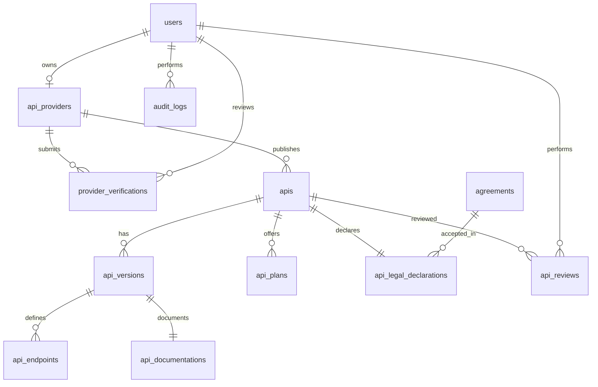

# ERD Sprint 2 — Issue #9

Trạng thái API hợp lệ: `Draft → Submitted → Under Review → Approved → Published`.
Từ `Under Review` có thể chuyển sang `Rejected`; Provider có thể đưa `Rejected` về `Draft` để chỉnh sửa và nộp lại. Trigger trong migration `003` chặn mọi chuyển trạng thái khác và chặn Provider chưa được xác minh nộp API.
