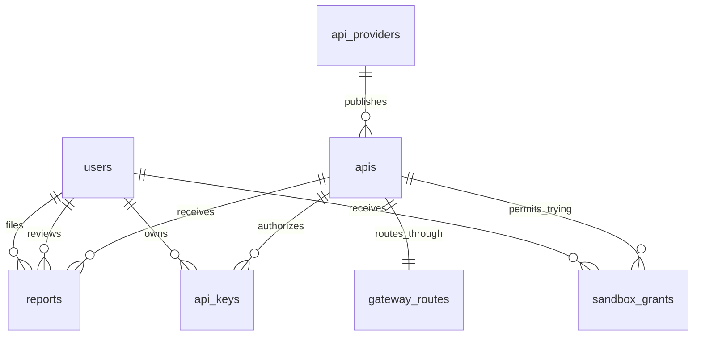

# ERD Sprint 3 — Marketplace, Gateway, Sandbox và API Key

- Một Consumer có nhiều Sandbox Grant, nhưng chỉ có một grant cho mỗi API (`UNIQUE (consumer_id, api_id)`).
- Một User có tối đa một API Key **active** cho mỗi API. Rotate/revoke sẽ vô hiệu hóa key cũ trước khi tạo key mới.
- Một API có tối đa một Gateway Route trong Sprint 3. Gateway chỉ forward khi route enabled và API `Published`.
- `usage_logs`/`request_history` được chốt thiết kế tại [sprint3-usage-log-design.md](./sprint3-usage-log-design.md); tạo bảng thật ở Sprint 4 cùng Subscription.
